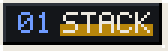
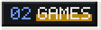

```text
                                             ⠀⠀⠀⠀⠀⢸⠓⢄⡀⠀⠀⠀⠀⠀⠀⠀⠀⠀⠀⠀⠀⠀⠀⠀⠀⠀⠀⠀⠀⠀
                                             ⠀⠀⠀⠀⠀⢸⠀⠀⠑⢤⡀⠀⠀⠀⠀⠀⠀⠀⠀⠀⠀⠀⠀⠀⠀⠀⠀⠀⠀⠀
                                             ⠀⠀⠀⠀⠀⢸⡆⠀⠀⠀⠙⢤⡷⣤⣦⣀⠤⠖⠚⡿⠁⠀⠀⠀⠀⠀⠀⠀⠀⠀
                                             ⣠⡿⠢⢄⡀⠀⡇⠀⠀⠀⠀⠀⠉⠀⠀⠀⠀⠀⠸⠷⣶⠂⠀⠀⠀⣀⣀⠀⠀⠀
 ooooooooo.    o8o                           ⢸⣃⠀⠀⠉⠳⣷⠞⠁⠀⠀⠀⠀⠀⠀⠀⠀⠀⠀⠈⠉⠉⠉⠉⠉⠉⠉⢉⡭⠋
 `888   `Y88.  `"'                           ⠀⠘⣆⠀⠀⠀⠁⠀⢀⡄⠀⠀⠀⠀⠀⠀⠀⠀⠀⠀⠀⠀⠀⠀⠀⢀⡴⠋⠀⠀
  888   .d88' oooo   .oooo.   ooo. .oo.      ⠀⠀⠘⣦⠆⠀⠀⢀⡎⢹⡀⠀⠀⠀⠀⠀⠀⠀⠀⡀⠀⠀⡀⣠⠔⠋⠀⠀⠀⠀
  888ooo88P'  `888  `P  )88b  `888P"Y88b     ⠀⠀⠀⡏⠀⠀⣆⠘⣄⠸⢧⠀⠀⠀⠀⢀⣠⠖⢻⠀⠀⠀⣿⢥⣄⣀⣀⣀⠀⠀
  888`88b.     888   .oP"888   888   888     ⠀⠀⢸⠁⠀⠀⡏⢣⣌⠙⠚⠀⠀⠠⣖⡛⠀⣠⠏⠀⠀⠀⠇⠀⠀⠀⠀⢙⣣⠄
  888  `88b.   888  d8(  888   888   888     ⠀⠀⢸⡀⠀⠀⠳⡞⠈⢻⠶⠤⣄⣀⣈⣉⣉⣡⡔⠀⠀⢀⠀⠀⣀⡤⠖⠚⠀⠀
 o888o  o888o o888o `Y888""8o o888o o888o    ⠀⠀⡼⣇⠀⠀⠀⠙⠦⣞⡀⠀⢀⡏⠀⢸⣣⠞⠀⠀⠀⡼⠚⠋⠁⠀⠀⠀⠀⠀
                                             ⠀⢰⡇⠙⠀⠀⠀⠀⠀⠀⠉⠙⠚⠒⠚⠉⠀⠀⠀⠀⡼⠁⠀⠀⠀⠀⠀⠀⠀⠀
                                             ⠀⠀⢧⡀⠀⢠⡀⠀⠀⠀⠀⠀⠀⠀⠀⠀⠀⠀⠙⣞⠁⠀⠀⠀⠀⠀⠀⠀⠀⠀
                                             ⠀⠀⠀⠙⣶⣶⣿⠢⣄⡀⠀⠀⠀⠀⠀⠀⠀⠀⠀⢸⠀⠀⠀⠀⠀⠀⠀⠀⠀⠀
                                             ⠀⠀⠀⠀⠀⠉⠀⠀⠀⠙⢿⣳⠞⠳⡄⠀⠀⠀⢀⡞⠀⠀⠀⠀⠀⠀⠀⠀⠀⠀
                                             ⠀⠀⠀⠀⠀⠀⠀⠀⠀⠀⠀⠉⠀⠀⠹⣄⣀⡤⠋⠀⠀⠀⠀⠀⠀⠀⠀⠀⠀⠀

 .-----------------------------------------------------------------------------.
 | (x) (-) (+)                     ~/about.txt                                 |
 |-----------------------------------------------------------------------------|
 |                                                                             |
 | Computer Science student at IFBA, Campus Paulo Afonso (Bahia, Brazil).      |
 |                                                                             |
 | I'm passionate about creating things, and games are where that passion      |
 | comes alive. If it can be built, I want to build it.                        |
 | -@Rian144hz                                                                 |
 |                                                                             |
 '-----------------------------------------------------------------------------'
```

<p></p>

<p>
  
</p>

<p></p>

<p>
  
</p>

<p></p>

<p>
  <a href="https://www.linkedin.com/in/matheus-souza7/"></a
  ><a href="https://www.tiktok.com/@rian144hz"></a
  ><a href="https://www.instagram.com/rian144hz/"></a
  ><a href="mailto:20252pa-0100024@ifba.edu.br"></a>
</p>

```text
 rian144hz@github ~ % exit
 logout
 Saving session...completed.

 [Process completed]▌
```
